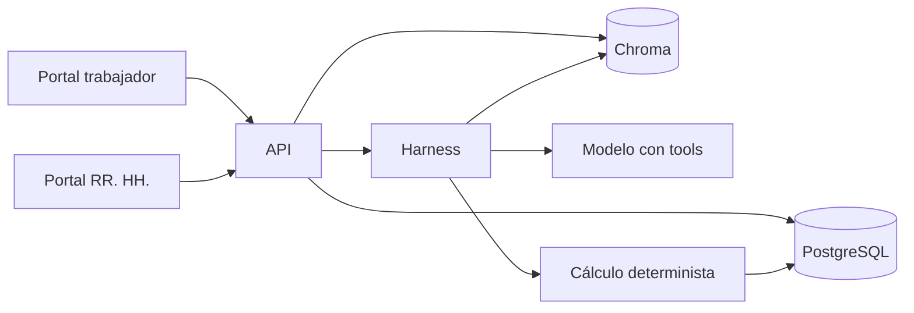

# RRHH Intelligence

Plataforma de autoservicio y revisión de remuneraciones. El trabajador consulta su liquidación y sus documentos. Recursos Humanos carga liquidaciones, contratos y anexos, y resuelve los casos en los que lo pagado no coincide con lo que corresponde.

Repositorio: [cmatii/rrhh-inteligence](https://github.com/cmatii/rrhh-inteligence)

La inteligencia artificial explica y marca diferencias. No es la fuente de verdad. Los montos, las fechas y las condiciones salen de la base y de los documentos. El modelo no calcula descuentos ni decide quién puede ver qué.

Los datos que trae el repositorio son sintéticos (Clínica Traumatología Cóndor, ficticia). No subas liquidaciones ni contratos reales.

## Qué hace hoy

Hay dos portales, ambos hablan solo con la API:

| Portal | URL | Para qué |
|---|---|---|
| Trabajador | http://localhost:8501 | Ve su liquidación por período y le pregunta al agente. |
| Recursos Humanos | http://localhost:8502 | Bandeja de casos, decisión y carga de archivos. |
| API | http://localhost:8000 | Único proceso que abre PostgreSQL y el índice de documentos. |

Recursos Humanos puede:

- Ver la bandeja. Cada liquidación con diferencias abre un caso al arrancar, sin volver a cargar un archivo de ejemplo.
- Comparar esperado contra pagado, con la causa de cada diferencia.
- Pedirle al agente una explicación y registrar una decisión (`mantener`, `corregir`, `derivar`) con nota.
- Cargar liquidaciones en Excel (plantilla) o en PDF con texto seleccionable.
- Cargar un contrato o un anexo, con fecha de vigencia y los campos de la ficha que cambian (AFP, sueldo, tipo de contrato, bono, asignación de turno).

La ficha que usa el cálculo es la vigente al cierre de ese mes: el contrato más los anexos cuya fecha ya llegó. Un anexo de septiembre no altera agosto.

El agente del trabajador tiene cuatro herramientas. El identificador de la persona viene de la sesión. Ninguna herramienta lo recibe como argumento.

| Herramienta | Qué consulta |
|---|---|
| `obtener_liquidacion` | Liquidación y perfil del período. |
| `calcular_descuentos_esperados` | AFP, salud, cesantía, impuesto y gratificación, comparados con lo pagado. |
| `consultar_parametros` | UF, UTM, topes y comisiones vigentes, con su fuente. |
| `buscar_en_documentos` | Contrato, anexos y documentos compartidos (reglamento, política de bonos, guía). |

## Qué no hace todavía

- No hay inicio de sesión real. En el portal del trabajador la persona se elige en la barra lateral.
- No lee PDF escaneados. Hace falta texto seleccionable.
- No ejecuta pagos ni modifica el sistema de remuneraciones.
- Buk está declarado como conector y responde que no está configurado. No hay integración con Defontana ni Talana.
- No hay consola de administración de usuarios, roles ni grupos.
- No modela instrumentos colectivos como entidad propia. El reglamento y la política de bonos están en el corpus compartido.
- El agente no recuerda la conversación. Cada pregunta es un turno nuevo. El historial de la pantalla no se reenvía al modelo.

## Cómo ejecutarlo

Requisito: Docker.

```bash
cp .env.example .env
docker compose up --build
```

| Servicio | Puerto |
|---|---|
| PostgreSQL | 5432 |
| API | 8000 |
| Portal del trabajador | 8501 |
| Portal de RR. HH. | 8502 |

La base vacía se llena una vez desde `data/`: trabajadores, contratos, documentos compartidos y liquidaciones. Los casos con diferencias aparecen al iniciar la API.

Por defecto el contenedor usa el Ollama del equipo (`host.docker.internal:11434`). El modelo tiene que aceptar *tool calling*.

```bash
ollama pull llama3.1:8b
ollama pull nomic-embed-text-v2-moe
```

Para levantar Ollama dentro de Docker: `docker compose --profile ollama up --build`, con `OLLAMA_BASE_URL=http://ollama:11434` en `.env`.

Sin modelo, en la configuración del portal del trabajador se puede usar LLM y embeddings en modo `mock`. También sirve para los tests.

```bash
docker compose run --rm --no-deps app pytest
```

Los tests usan SQLite y la API en proceso. No tocan PostgreSQL.

## Arquitectura



PostgreSQL guarda trabajadores, documentos, liquidaciones y casos. Chroma indexa el texto de los documentos que están en esa base. `data/` solo siembra una base vacía. `data/parametros_2026.json` sigue siendo el archivo de tasas y topes, porque cambian y no deben quedar congelados dentro de un documento indexado.

Una carga o una decisión entra por la API, se escribe en la base y, si cambia la ficha, se recalculan los casos del trabajador desde esa fecha.

## Datos que ya viven en la base

| Tabla | Contenido |
|---|---|
| `trabajadores` | Ficha base: cargo, AFP, salud, sueldo, tipo de contrato, bonos. |
| `documentos` | Contrato, anexos y documentos compartidos. Vigencia, descripción y campos que cambian. |
| `liquidaciones` | Una por trabajador y período, con el origen (`base`, `excel`, `pdf`). |
| `casos` | Diferencias, severidad, estado, nota e informe del agente. |

Campos que un contrato o un anexo pueden cambiar en la ficha: `afp`, `salud`, `tipo_contrato`, `fecha_termino`, `jornada`, `sueldo_base`, `colacion`, `movilizacion`, `asignacion_turno`, `bono_monto`, `bono_meta_atenciones`.

El conjunto sintético tiene cuatro personas y liquidaciones de agosto y septiembre de 2026. Septiembre abre casos. Agosto cuadra con el contrato.

| Id | Persona | Qué revisar en septiembre |
|---|---|---|
| W001 | Camila Rojas, kinesióloga | AFP distinta a la del contrato, y bono de productividad en cero. |
| W002 | Tomás Aguilera, técnico paramédico | Cuadra. No abre caso. |
| W003 | Valentina Cortés, médica | AFP y salud calculadas sobre el tope imponible. |
| W004 | Diego Fuentes, ejecutivo de admisión | Cesantía en un contrato a plazo fijo. |

## Seguridad que ya está, y la que falta

Ya está:

- El identificador del trabajador lo fija la sesión. El modelo no puede pedirlo ni cambiarlo.
- La búsqueda documental filtra por esa persona y por los documentos compartidos.
- La salida del agente tiene que cumplir `agent/output.schema.json`. Si no cumple, el harness reintenta una vez.
- Una fuente citada tiene que haber sido recuperada en esa misma ejecución.
- La clave del proveedor de modelo va en `.env` y no se devuelve en la configuración de la API.

Falta, y es requisito antes de usar datos reales:

- Autenticación y autorización de verdad, también para el analista.
- Cifrado y política de retención.
- Que un documento cargado no pueda reescribir las instrucciones del agente.
- Auditoría de accesos más allá de la nota del caso y la traza de la ejecución.

## Hoja de ruta

El documento de visión está en el origen de este README. El estado frente a ese plan:

| Etapa | Estado |
|---|---|
| 0. Auditar el prototipo | Hecho en este repositorio. La arquitectura de arriba es la que corre. |
| 1. Trabajadores, documentos y permisos | Trabajadores, contratos, anexos y vigencia están en PostgreSQL. Falta identidad y permisos. |
| 2. Ingesta y datos estructurados | Excel y PDF con texto ya cargan liquidaciones. El cálculo compara contra la ficha vigente. Falta OCR y revisión de campos dudosos antes de darlos por confirmados. |
| 3. Consultas con fuentes | El portal del trabajador y la explicación de un caso ya usan el harness. Falta memoria de conversación y evaluación continua fuera de la suite de tests. |
| 4. ERP | El conector Buk está reservado y apagado. Defontana y Talana no están. |

## Estructura

```text
api/         FastAPI. Salud, trabajadores, consultas, casos, cargas.
app/         Portal del trabajador (Streamlit).
rrhh/        Portal de RR. HH. (Streamlit) y reglas de la bandeja.
cliente/     Cliente HTTP que usan los dos portales.
harness/     Agente, tools, cálculo, almacén y retriever.
fuentes/     Excel, PDF de liquidación, contrato, anexo. Buk sin configurar.
agent/       Instrucciones, manifiesto y contrato de salida.
data/        Semilla de una base vacía y parámetros normativos.
tests/       Suite offline.
docs/        Arquitectura, límites de negocio y material del caso de origen.
```

## Variables de entorno

Copia `.env.example` a `.env`. No subas `.env`.

| Variable | Defecto | Uso |
|---|---|---|
| `LLM_PROVIDER` | `ollama` | `ollama`, `unab` (API compatible con OpenAI) o `mock`. |
| `LLM_MODEL` | `llama3.1:8b` | Tiene que aceptar *tool calling*. Con el proveedor `unab` se ha usado `gemma4:26b`. |
| `EMBEDDINGS_PROVIDER` | `ollama` | `ollama` o `mock`. |
| `EMBEDDING_MODEL` | `nomic-embed-text-v2-moe` | Si cambia, hay que reconstruir el índice. |
| `OLLAMA_BASE_URL` | `http://localhost:11434` | En Compose, el servicio de la API apunta al Ollama del host. |
| `UNAB_BASE_URL` / `UNAB_API_KEY` | — | Solo si `LLM_PROVIDER=unab`. |
| `DATABASE_URL` | SQLite local | En Compose es PostgreSQL. No hace falta definirla a mano. |
| `API_BASE_URL` | — | La usan los portales dentro de Compose (`http://api:8000`). |

`RETRIEVER_K` (4) y `AGENT_MAX_STEPS` (8) se pueden sobreescribir. El índice se reconstruye solo si cambia la huella de los documentos o del modelo de embeddings. También se puede reconstruir desde la configuración del portal del trabajador.

## Límites

Los parámetros legales de `data/parametros_2026.json` se verificaron el 2026-10-07. Hay que volver a verificarlos antes de cualquier uso con remuneraciones reales.

El agente explica y marca diferencias. No certifica cumplimiento legal ni reemplaza la revisión de Recursos Humanos. El detalle de lo que el cálculo todavía no cubre está en `docs/gaps_de_negocio.md`.
